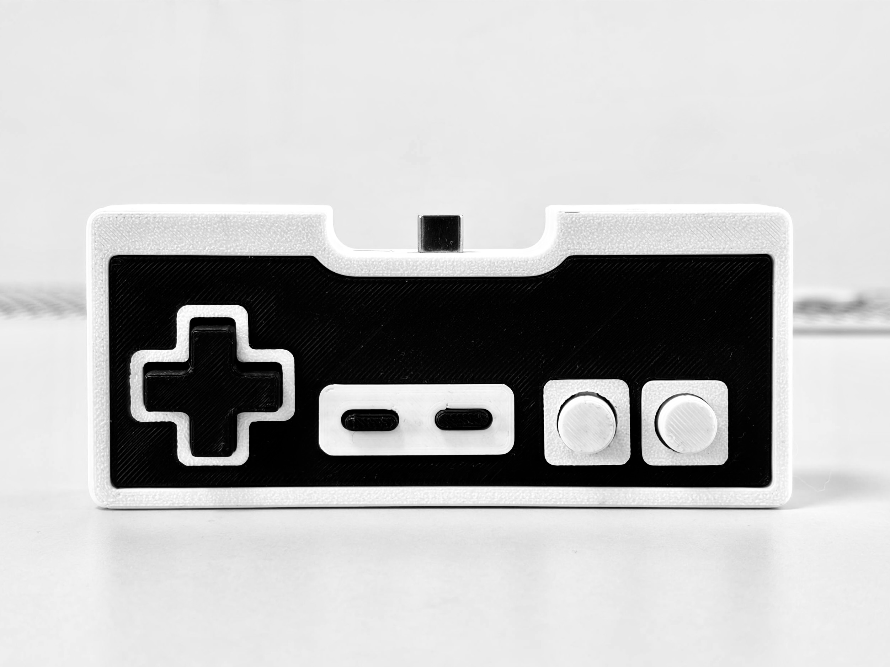
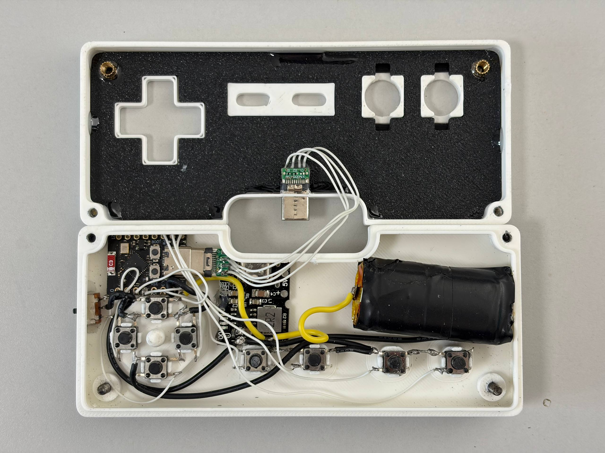

# InkBoy controller



A small handheld gamepad built around an ESP32-C3 SuperMini. It has eight
buttons (D-pad, A, B, Select, Start) and talks to
[InkBoy](https://github.com/kuslota/InkBoy) either over Bluetooth LE (as a
HID gamepad) or over a USB-C cable (as a serial device).

## Parts needed

### Electronics:

- ESP32-C3 SuperMini board
- 8× tactile switches (6×6×6 mm, 4-pin)
- LiPo battery sized to fit the enclosure
- LiPo charger / 5 V boost board
- Power switch
- 2× USB-C male breakout adapters with VBUS/5V, D+, D− and GND pins

### Enclosure:

- 3D-printed enclosure, see [hardware/](hardware/)
- 4x M3-14 screws
- 2x M3 threaded insert
- hot glue / superglue / epoxy

## Wiring

Each button connects between its GPIO and **ESP32-C3 GND**. The firmware enables
internal pull-ups, so no external button resistors are needed.

```text
ESP32-C3 GPIO ─── momentary button ─── ESP32-C3 GND
```

The published build uses this default layout:

| Button | Down | Left | Up | Right | Select | B | A | Start |
| ------ | ---- | ---- | -- | ----- | ------ | - | - | ----- |
| GPIO   | 0    | 1    | 2  | 3     | 4      | 5 | 6 | 7     |

You can arrange the buttons on GPIO0–7 however you like, then use
**Settings → Controller → Map buttons** in InkBoy. The same mapping works over
Bluetooth and USB. To use different GPIOs, first change the eight-entry `pins[]`
array in [src/main.cpp](src/main.cpp), rebuild, and remap. GPIO8 is the status LED.

Power wiring in this build:

```text
Battery + ─────────────────────── Charger module BAT+
Battery − ─────────────────────── Charger module BAT−

Charger module 5V+ ──── ESP32-C3 5V
Charger module GND ──── Power switch ──── ESP32-C3 GND
```

The switch opens the module's ground return to the C3. USB can still power the
controller with this switch open.

The two USB-C **male breakout adapters** form an extension: one plugs into the
C3's USB-C socket; the other is mounted at the enclosure opening and plugs into
InkBoy. Connect matching signals:

```text
Plug in C3 socket                   External plug to InkBoy
  VBUS / 5V ──────────────────────── VBUS / 5V
  D+        ──────────────────────── D+
  D−        ──────────────────────── D−
  GND       ──────────────────────── GND
```

Match the printed signal labels, not the physical pin order. This diagram shows
the four wired signals in this build; the adapters' USB-C CC configuration must
also suit the connection.



The photo shows the physical arrangement and USB extension. Follow the diagrams
for the connections; wire colors and routing are specific to this build.

## Build and flash

Install [PlatformIO](https://platformio.org/), then:

```sh
pio run -t upload
pio device monitor
```

To enter download mode on a SuperMini, hold BOOT, press and release RESET,
then release BOOT. Alternatively, hold BOOT while restoring power from a fully
unpowered state. Reconnecting USB alone does not reset a controller still
powered by its battery. The board then appears as a serial port for flashing.

## Connecting to InkBoy

Bluetooth: power the controller on. Current InkBoy firmware connects
automatically to this controller, which advertises as `ESP32 Gamepad`.
Keep that name when building this firmware; other BLE gamepads are not yet
supported by InkBoy.

USB: plug the enclosure's external USB-C plug into InkBoy and choose
**Settings → Controller → Connection → USB**. A controller built with a USB-C
socket instead needs a suitable USB data cable.

## Credits

- Enclosure: "8-Bit Nintendo Gamepad Controller" by SBPS,
  https://www.thingiverse.com/thing:5215921, modified for this project. See
  [hardware/ATTRIBUTION.md](hardware/ATTRIBUTION.md).
- [ESP32-BLE-Gamepad](https://github.com/lemmingDev/ESP32-BLE-Gamepad) by
  lemmingDev and [NimBLE-Arduino](https://github.com/h2zero/NimBLE-Arduino) by
  h2zero. See [THIRD_PARTY_NOTICES.md](THIRD_PARTY_NOTICES.md).

## Licenses

- Firmware, tests and documentation: MIT, see [LICENSE](LICENSE).
- Everything in `hardware/`: Creative Commons Attribution (CC BY), same as the
  original enclosure, not MIT. See [hardware/ATTRIBUTION.md](hardware/ATTRIBUTION.md).
- Third-party libraries: see [THIRD_PARTY_NOTICES.md](THIRD_PARTY_NOTICES.md).
